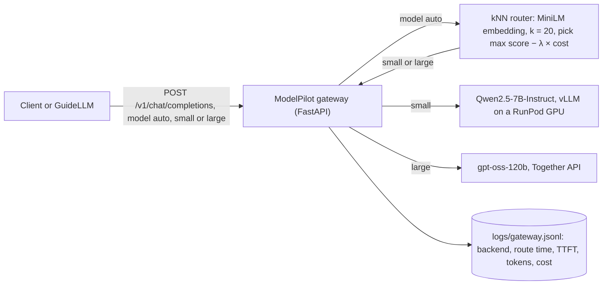
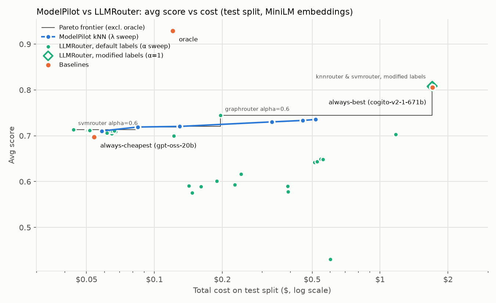

# ModelPilot

An LLM router: for each incoming query, pick the **cheapest model that is likely to answer it well**, instead of sending everything to one expensive model.

It learns from [xRouteBench](https://huggingface.co/datasets/ulab-ai/xRouteBench) (`ulab-ai/xRouteBench`), where 18 open models were each run on the same ~8,200 queries (math, code, multiple choice, reading comprehension) and scored. An OpenAI-compatible gateway routes each request between a self-hosted small model (Qwen2.5-7B on a rented GPU) and a large hosted one (gpt-oss-120b on Together), and was load-tested live with GuideLLM.



## How it works

1. **Cost per call.** For every (query, model) pair: `input_tokens × input_price / 1M + output_tokens × output_price / 1M`, using the model's real token counts and prices from the dataset.
2. **Embed queries.** Each query becomes a 384-number vector with the `all-MiniLM-L6-v2` sentence encoder; similar queries get nearby vectors.
3. **k-nearest neighbours.** For a new query, find the k most similar training queries (cosine similarity). Each model's **predicted score** and **predicted cost** is the similarity-weighted average of how it did on those k. The default is k = 20, chosen on validation (see [Learned router](#learned-router)); the Results and LLMRouter tables below were run earlier with k = 10.
4. **Decide.** Pick the model with the highest `predicted_score − λ × predicted_cost` (cost in $ per 1,000 queries). Ties go to the cheaper model. λ is the price of quality: λ = 0 ignores cost, larger λ favours cheaper models.

**Avg score** below is the mean of the dataset's `performance` column: 0/1 for most tasks, F1 between 0 and 1 for SQuAD. It is not called "accuracy" because of that partial credit.

### Baselines

- **always-cheapest**: the model with the lowest average cost on the train split (`gpt-oss-20b`).
- **always-best**: the model with the highest train avg score (`cogito-v2-1-671b`).
- **oracle**: per query, the model that actually scored highest, cheapest on ties. It sees the answers, so no real router can match it; it shows how much room there is.

Fixed models are chosen from the **train** split and everything is evaluated on the **test** split (3,729 queries, no overlap with train).

## Results

| Strategy | Avg score | Total cost ($) | Cost vs always-best |
|---|---:|---:|---:|
| always-cheapest (gpt-oss-20b) | 0.698 | 0.054 | 3% |
| router λ=10 | 0.710 | 0.058 | 3% |
| router λ=3 | 0.719 | 0.084 | 5% |
| oracle | 0.929 | 0.121 | 7% |
| router λ=1 | 0.720 | 0.129 | 8% |
| router λ=0.3 | 0.730 | 0.331 | 19% |
| router λ=0.1 | 0.733 | 0.455 | 27% |
| router λ=0 | 0.736 | 0.518 | 30% |
| always-best (cogito-v2-1-671b) | 0.805 | 1.707 | 100% |


**Reading the results**

- The oracle beats the best single model (0.929 vs 0.805) at 7% of its cost: cheap models are right on most queries, *if* you know which ones.
- The router at **λ = 3** improves on always-cheapest (+0.021 avg score) for $0.03 more; lower λ adds little score for much more cost.
- The router does not reach always-best. kNN over MiniLM embeddings can't reliably tell which queries a cheap model will get right; only ~58% of a query's neighbours come from the same task.

Experiments are recorded in [DECISIONS.md](DECISIONS.md) and `results/v1`–`v3`: similarity weighting with cost tie-breaks was kept; stripping the shared instruction template before embedding was tested (v2) and reverted, because the instruction text tells the router what kind of task it is.

## Comparison with LLMRouter

[LLMRouter](https://github.com/ulab-uiuc/LLMRouter) (commit `c65ee01`) is the official router library for xRouteBench. Its `benchmark_pipeline` was run on the same train/test split, CPU-only, with no API calls: it replays the recorded test outcomes, and its fixed-model baselines score exactly the same as ModelPilot's evaluation.

What the rows mean:

- **Embeddings: MiniLM for every row.** LLMRouter's standard embedding model, Qwen3-Embedding-0.6B (behind its published numbers), was **not run**: it needs ~4 hours on this CPU. Both systems therefore see the same `all-MiniLM-L6-v2` vectors, so only the routing method differs. These numbers are not comparable to LLMRouter's published ones.
- **Labels "default"**: LLMRouter's code and training labels, unchanged.
- **Labels "modified labels"**: my modification, for knnrouter and svmrouter at α = 1.0 only. LLMRouter labels each train query with the single best model, but on 93.6% of train queries several models tie, and the tie goes to whichever model is listed first (qwen2.5-7b-instruct, a weak model): 58.6% of all labels. The modified rows break ties toward the model with the highest train avg score instead. The data file is reordered; LLMRouter's code is not changed.

Pure-performance training (α = 1.0, LLMRouter's default):

| Router | Labels | Avg score | Total cost ($) |
|---|---|---:|---:|
| ModelPilot kNN, λ = 0 | – | 0.736 | 0.518 |
| LLMRouter knnrouter | default | 0.589 | 0.161 |
| LLMRouter svmrouter | default | 0.591 | 0.142 |
| LLMRouter mlprouter | default | 0.616 | 0.242 |
| LLMRouter mfrouter | default | 0.601 | 0.189 |
| LLMRouter hybrid_llm | default | 0.648 | 0.558 |
| LLMRouter elorouter | default | 0.576 | 0.147 |
| LLMRouter graphrouter | default | 0.430 | 0.601 |
| LLMRouter knnrouter | **modified labels** | 0.808 | 1.697 |
| LLMRouter svmrouter | **modified labels** | 0.808 | 1.705 |
| always-best (cogito-v2-1-671b) | – | 0.805 | 1.707 |

With modified labels, knnrouter and svmrouter route ~99% of queries to cogito-v2-1-671b, so they match always-best.

Cost-aware training: LLMRouter's α sweep (α = 0.8, 0.6, 0.4, 0.2, β = 1 − α) for the 7 trainable routers, next to ModelPilot's λ sweep. Every row is on the chart; the line is the Pareto frontier (oracle excluded).



Rows on the frontier, cheapest first:

| Router | Setting | Avg score | Total cost ($) |
|---|---|---:|---:|
| LLMRouter svmrouter | α = 0.6 | 0.714 | 0.044 |
| ModelPilot kNN | λ = 3 | 0.719 | 0.084 |
| ModelPilot kNN | λ = 1 | 0.720 | 0.129 |
| LLMRouter graphrouter | α = 0.6 | 0.744 | 0.196 |
| LLMRouter knnrouter / svmrouter | modified labels, α = 1.0 | 0.808 | 1.70 |

What this says:

- **Cheap end:** LLMRouter's svmrouter and knnrouter (α ≤ 0.8) collapse to roughly "always gpt-oss-20b, with a few swaps" and cost less than ModelPilot λ = 10. A paired bootstrap (1,000 resamples) finds no real score difference against λ = 10 (svm α = 0.8: +0.003, 95% CI [−0.007, +0.012]), but both beat always-cheapest (+0.016 [+0.010, +0.022]). See [bootstrap_cheap_end.md](results/v4_llmrouter/bootstrap_cheap_end.md).
- **Middle:** ModelPilot λ = 1 and λ = 3 stay on the frontier.
- **λ ≤ 0.3:** dominated by graphrouter α = 0.6 (higher score, lower cost). graphrouter is unstable across α (0.43 to 0.74 avg score, not monotonic, one training run each), so treat that point as a single lucky run, not a reliable setting.

Full results: [results/v4_llmrouter/comparison.csv](results/v4_llmrouter/comparison.csv).

## Learned router

A small MLP (scikit-learn `MLPRegressor`, one hidden layer) predicts all 18 models' scores from the MiniLM embedding, and a Ridge regression predicts each model's cost. Routing uses the same rule as kNN: pick the model with the highest predicted score − λ × predicted cost.

Tuning never touches test. 20% of train queries (897, split per task) are held out as validation; every setting is picked there:

- kNN k = 20 (was 10), MLP hidden = 256 with L2 alpha = 1, Ridge alpha = 0.1, chosen by validation MSE of the predicted scores and costs.
- Default λ = 1 (was 3): the largest λ whose validation avg score is within 0.01 of the best λ.
- Rule for replacing kNN: at the default λ, the MLP's avg score must beat kNN with a paired-bootstrap 95% CI above 0, at no more than 10% higher cost. On validation the MLP scored −0.012 [−0.032, +0.005], so **kNN stays the default**.

Then both routers were refit on the full train split and run on test **once**:

| λ | kNN avg score | kNN cost ($) | MLP avg score | MLP cost ($) |
|---:|---:|---:|---:|---:|
| 0 | 0.748 | 0.806 | 0.781 | 1.137 |
| 0.1 | 0.749 | 0.663 | 0.757 | 0.473 |
| 0.3 | 0.740 | 0.316 | 0.752 | 0.215 |
| **1** | **0.732** | **0.124** | **0.746** | **0.149** |
| 3 | 0.725 | 0.085 | 0.739 | 0.082 |
| 10 | 0.710 | 0.054 | 0.719 | 0.063 |

On test the MLP scores higher at every λ. At λ = 1 the gain is significant (+0.014, 95% CI [+0.003, +0.024]) but costs 20% more, so it would fail the replacement rule on test as well. The default was fixed before test was run and is not changed after seeing it. Validation and test disagree, which suggests the 897-query validation slice is too small to separate the two routers reliably. Details: [results/v6_learned/](results/v6_learned/).

## Gateway

`modelpilot.gateway` is an OpenAI-compatible `/v1/chat/completions` endpoint, so any OpenAI client or benchmark tool can call it.

- `"model": "auto"` routes with kNN (k = 20) restricted to the two backends, at λ = `ROUTER_LAMBDA` (default 1) or a per-request `"lambda"` field. The routing text is the last user message.
- `"model": "small"` / `"large"` force a backend (used for the all-small and all-large benchmark runs).
- Streaming (SSE) is passed through unchanged; the gateway asks the backend for a final usage chunk so every request is logged with its tokens.
- Each request is one JSON line in `logs/gateway.jsonl`: requested model, backend, λ, route time, TTFT, latency, tokens and cost. The response carries an `x-modelpilot-backend` header.

| Backend | Model | Served by | Price per 1M tokens (in / out, xRouteBench) |
|---|---|---|---|
| small | qwen2.5-7b-instruct | vLLM on a 24 GB RunPod GPU (`Qwen/Qwen2.5-7B-Instruct`) | $0.20 / $0.20 |
| large | gpt-oss-120b | Together (`openai/gpt-oss-120b`) | $0.15 / $0.60 |

Offline, on the full test split with only these two models:

| Setup | Avg score | Total cost ($, dataset tokens) |
|---|---:|---:|
| all-small | 0.575 | 0.147 |
| all-large | 0.744 | 0.196 |
| routed λ = 1 | 0.743 | 0.144 |

Per token, the "large" model is not the expensive one: at dataset prices gpt-oss-120b is cheaper than qwen2.5-7b on 61% of test queries, because its answers are shorter, so the router sends ~70% of queries to large. Large was going to be Llama-3.3-70B, but Together removed it from serverless on 2026-10-22 (see [DECISIONS.md](DECISIONS.md)). The real cost question is the GPU hour for self-hosting small, which is what the live benchmark measures.

## Live benchmark

[GuideLLM](https://github.com/vllm-project/guidellm) 0.8.1 sent the 3,729 test queries (shuffled) through the gateway at concurrency 1, 8 and 32 for 60 s each, with output capped at 512 tokens. Small ran on an RTX 3090 ($0.50/h, RunPod Secure Cloud); all-large ran before the pod was deployed.

- **Token cost / 1k**: xRouteBench prices × the live token counts.
- **Live cost / 1k**: what was actually paid: Together tokens for large, plus GPU $/h × the 60 s window for setups that use the pod (the GPU bills even when idle).
- **Expected avg score**: offline, from the table above. It is not measured live.

| Setup | Conc. | Req/s | TTFT median (ms) | Latency median / p95 (s) | Route ms (median) | Share large | Token cost / 1k ($) | Live cost / 1k ($) | Expected avg score | Errors |
|---|---:|---:|---:|---|---:|---:|---:|---:|---:|---:|
| all-small | 1 | 0.63 | 284 | 0.40 / 7.63 | 0 | 0% | 0.046 | 0.219 | 0.575 | 0 |
| all-small | 8 | 5.00 | 375 | 0.51 / 8.08 | 0 | 0% | 0.043 | 0.027 | 0.575 | 0 |
| all-small | 32 | 15.33 | 582 | 0.79 / 9.51 | 0 | 0% | 0.041 | 0.009 | 0.575 | 1 |
| all-large | 1 | 0.27 | 451 | 3.31 / 7.15 | 0 | 100% | 0.200 | 0.200 | 0.744 | 0 |
| all-large | 8 | 2.40 | 437 | 2.84 / 6.34 | 0 | 100% | 0.176 | 0.176 | 0.744 | 4 |
| all-large | 32 | 7.90 | 1083 | 3.23 / 7.52 | 0 | 100% | 0.164 | 0.164 | 0.744 | 0 |
| routed λ = 1 | 1 | 0.22 | 604 | 3.67 / 11.10 | 67 | 71% | 0.131 | 0.704 | 0.743 | 0 |
| routed λ = 1 | 8 | 2.23 | 488 | 2.60 / 7.63 | 71 | 73% | 0.127 | 0.170 | 0.743 | 0 |
| routed λ = 1 | 32 | 8.00 | 805 | 2.91 / 8.03 | 143 | 77% | 0.132 | 0.136 | 0.743 | 0 |

Full table (with output tokens/s and TTFT p95) and the session cost: [results/v5_live/live_results.md](results/v5_live/live_results.md). Errors, empty replies and live vs offline cost: [results/v5_live/live_details.md](results/v5_live/live_details.md).

**Reading the results**

- **Under load, routing pays.** At concurrency 32, routed keeps all-large's expected score (0.743 vs 0.744) at 17% lower live cost ($0.136 vs $0.164 per 1k requests). All-small is by far the cheapest ($0.009) but scores 0.575.
- **At low load, self-hosting doesn't.** At concurrency 1 the GPU is mostly idle, so routed is the most expensive setup ($0.704 per 1k). The GPU only pays off when it is kept busy.
- **Routing overhead** is 67 ms median at concurrency 1 and 143 ms at 32: the MiniLM embedding runs on the gateway's CPU and queues under load.
- **gpt-oss-120b's live cost is 3.3× the dataset's** on the same queries (qwen: 1.14×). It reasons before answering and the reasoning tokens bill as output: 222 output tokens per reply live vs 56 in xRouteBench. The router's cost predictions for large are therefore ~3× too low, which probably pushes too many queries to large.
- **Empty replies.** 13% of all-large replies (8–15% of routed, 0% of all-small) came back with no answer: the reasoning used up the whole 512-token budget. The expected avg score doesn't account for this, so it overstates large and routed at this cap.
- **Errors**: 4 × HTTP 503 from Together in the same 1.8 s at the start of the all-large concurrency-8 run, and 1 × HTTP 502 on small at concurrency 32. Nothing stored the response bodies, so the causes are unknown.
- **Session cost**: the pod ran 9 min 38 s from deploy to delete, $0.080 (an earlier pod, aborted before benchmarking, cost $0.16). Live cost / 1k counts only the benchmark windows, not model loading.

## Live API

`POST /route` returns the model the router picks. `POST /chat` routes the query, then calls the model on NVIDIA's API.

NVIDIA currently serves only 2 of the 18 candidates (`mistral-7b-instruct-v0.3` and `openai/gpt-oss-20b`); the other dataset models have been retired there. At startup the app fetches NVIDIA's model list. If the routed model is available it is called directly; otherwise `/chat` falls back to the available candidate with the highest train avg score (today `gpt-oss-20b`) and says so in the response.

```bash
curl -X POST localhost:8000/route -H 'Content-Type: application/json' \
     -d '{"query": "What is 17 * 23?"}'
# {"model":"gpt-oss-20b","service":"Together","api_model_id":"openai/gpt-oss-20b",
#  "predicted_score":0.72,"predicted_cost_per_1k_queries":0.027}

curl -X POST localhost:8000/chat -H 'Content-Type: application/json' \
     -d '{"query": "Write a Python function that checks for palindromes.", "lambda": 3, "max_tokens": 300}'
# {"routed_model":"qwen2.5-7b-instruct","served_model":"gpt-oss-20b",
#  "api_model_id":"openai/gpt-oss-20b","fallback":true,"response":"..."}
```

`lambda` is optional (default 1, chosen on validation). Interactive docs are at http://localhost:8000/docs.

## How to run

Requires [uv](https://docs.astral.sh/uv/) and Python 3.12. Runs on CPU (PyTorch is installed from the CPU-only wheel index).

```bash
uv sync                                    # install dependencies

uv run python scripts/model_table.py       # per-model avg score and cost (train)
uv run python scripts/baselines.py         # baselines on test
uv run python scripts/evaluate_router.py --out results/v3   # router λ sweep
uv run python scripts/make_results.py      # results/results.md + results/cost_vs_score.png
uv run python scripts/tune_routers.py      # tune kNN + MLP on validation (no test data)
uv run python scripts/compare_learned.py   # one-time test comparison, kNN vs MLP

uv run pytest                              # unit tests (no data or network needed)
```

The first run downloads the dataset and the encoder, and embedding all queries takes ~7 minutes on CPU. Embeddings are cached in `cache/`; delete it if you change how queries are embedded.

For the API, put your NVIDIA key in `.env` (gitignored):

```
NVIDIA_API_KEY=nvapi-...
```

then, from the repo root:

```bash
uv run uvicorn modelpilot.api:app --port 8000
```

### Gateway without a GPU

A fake backend stands in for both models: it waits `FAKE_DELAY_SECONDS`, then returns `max_tokens` dummy tokens (streaming or not, with usage). No keys needed.

```bash
FAKE_DELAY_SECONDS=0.5 uv run uvicorn modelpilot.fake_backend:app --port 8001 &
LARGE_BASE_URL=http://localhost:8001/v1 uv run uvicorn modelpilot.gateway:app --port 8000

curl -s localhost:8000/v1/chat/completions -H 'Content-Type: application/json' \
     -d '{"model": "auto", "messages": [{"role": "user", "content": "What is 17 * 23?"}], "max_tokens": 20}'
tail -1 logs/gateway.jsonl     # which backend was picked, route time, tokens, cost
```

(The small backend already defaults to `http://localhost:8001/v1`.) The whole benchmark pipeline can be dry-run the same way; see [docs/gpu_session.md](docs/gpu_session.md).

### Gateway with a GPU

[docs/gpu_session.md](docs/gpu_session.md) is the step-by-step session: deploy vLLM on RunPod with an API key, check it, point the gateway at it, benchmark, terminate. In short:

```bash
uv tool install guidellm==0.8.1
scripts/live_benchmark.sh large          # before deploying: needs only TOGETHER_API_KEY
# deploy the pod, pass the health checks, set SMALL_BASE_URL, then:
scripts/live_benchmark.sh small auto     # ~8 min of GPU time
# terminate the pod, then:
uv run python scripts/summarize_live.py --gpu-price-per-hour 0.50 --gpu "RTX 3090"
uv run python scripts/live_details.py    # errors, empty replies, live vs offline cost
```

### `.env` variables

`.env` is gitignored; never commit it or print its values.

| Variable | Used for | Default |
|---|---|---|
| `NVIDIA_API_KEY` | `/route` and `/chat` demo API | none |
| `TOGETHER_API_KEY` | gateway large backend | none |
| `SMALL_API_KEY` | vLLM `--api-key` on the pod, and the gateway's key for small | none |
| `SMALL_BASE_URL` | small backend URL (`https://<POD_ID>-8000.proxy.runpod.net/v1` during a session) | `http://localhost:8001/v1` |
| `LARGE_BASE_URL` | large backend URL | `https://api.together.xyz/v1` |
| `SMALL_MODEL_ID`, `LARGE_MODEL_ID` | model id sent to the backend | `Qwen/Qwen2.5-7B-Instruct`, `openai/gpt-oss-120b` |
| `SMALL_ROUTER_MODEL`, `LARGE_ROUTER_MODEL` | xRouteBench model the router and prices use | `qwen2.5-7b-instruct`, `gpt-oss-120b` |
| `ROUTER_LAMBDA` | default λ for `model: auto` | `1` |
| `GATEWAY_LOG` | request log path | `logs/gateway.jsonl` |
| `FAKE_DELAY_SECONDS` | fake backend delay before the first token | `0.5` |
| `RUNPOD_API_KEY` | optional, only for driving RunPod from its API or `runpodctl`; no repo code reads it | none |

## Project layout

```
src/modelpilot/
  data.py         load the dataset configs
  cost.py         dollar cost per call
  summary.py      per-model avg score / avg cost
  baselines.py    always-cheapest, always-best, oracle
  evaluation.py   avg score and total cost of any strategy
  embeddings.py   MiniLM embeddings with disk cache
  router.py       kNN prediction and the λ decision rule
  learned.py      MLP score + Ridge cost router
  validation.py   validation split, default-λ and replacement rules
  stats.py        paired bootstrap
  report.py       results table and chart
  nvidia.py       NVIDIA API client
  serving.py      routed model vs NVIDIA fallback
  api.py          FastAPI app (/route, /chat)
  gateway_config.py  small/large backends from env
  gateway.py      OpenAI-compatible routing gateway
  fake_backend.py stand-in backend for tests and dry runs
  live.py         cost per benchmark window from the gateway log
scripts/          runnable scripts for each step
  live_prompts.py     test queries as GuideLLM prompts
  live_benchmark.sh   GuideLLM runs through the gateway
  summarize_live.py   live results table
  live_details.py     errors, empty replies, live vs offline cost
docs/gpu_session.md   RunPod + vLLM session guide
tests/            pytest unit tests
results/          sweep CSVs (v1–v3), LLMRouter comparison (v4), live benchmark (v5_live), learned router (v6)
```

## Limitations

- Live queries don't carry the dataset's instruction template, so live routing is less task-aware than the offline evaluation.
- The test split's task mix differs from train (e.g. 500 vs 63 MMLU-Pro queries), which the router has to cope with.
- k and the default λ were tuned on a 897-query validation slice, which is small: validation and test disagree on kNN vs MLP.
- The router's cost predictions come from dataset token counts. Live, gpt-oss-120b used 3.3× the cost the dataset predicts (reasoning tokens), so the gateway's λ = 1 decisions treat large as ~3× cheaper than it is. The router was not retuned on the live numbers.
- At a 512-token cap, 13% of gpt-oss-120b replies were empty (all reasoning, no answer). The expected avg score in the live table is offline and doesn't include this.
- The large backend is gpt-oss-120b, not the originally planned Llama-3.3-70B (removed from Together serverless). At dataset prices it is cheaper per query than the small model on 61% of queries, so this two-model setup doesn't test "cheap small vs expensive large" per token; the cost difference is GPU hours.
- Routing embeds on the gateway's CPU: about 23 queries/s at most on the laptop used, 143 ms median route time at concurrency 32. A busier gateway would need a faster encoder or more CPU.
- The live numbers come from one session on one GPU type, 60 s per concurrency level. The concurrency-1 rows rest on 13–38 requests.
