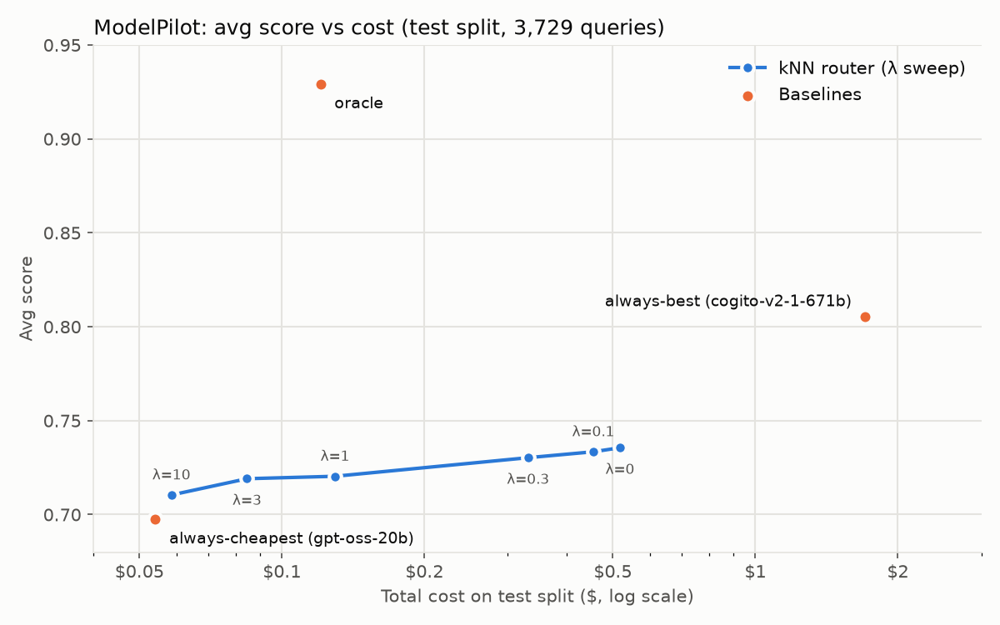

# ModelPilot

An LLM router: for each incoming query, pick the **cheapest model that is likely to answer it well**, instead of sending everything to one expensive model.

It learns from [xRouteBench](https://huggingface.co/datasets/ulab-ai/xRouteBench) (`ulab-ai/xRouteBench`), where 18 open models were each run on the same ~8,200 queries (math, code, multiple choice, reading comprehension) and scored. A FastAPI service exposes the router and can answer queries live through NVIDIA's OpenAI-compatible API.

## How it works

1. **Cost per call.** For every (query, model) pair: `input_tokens × input_price / 1M + output_tokens × output_price / 1M`, using the model's real token counts and prices from the dataset.
2. **Embed queries.** Each query becomes a 384-number vector with the `all-MiniLM-L6-v2` sentence encoder; similar queries get nearby vectors.
3. **k-nearest neighbours.** For a new query, find the 10 most similar training queries (cosine similarity). Each model's **predicted score** and **predicted cost** is the similarity-weighted average of how it did on those 10.
4. **Decide.** Pick the model with the highest `predicted_score − λ × predicted_cost` (cost in $ per 1,000 queries). Ties go to the cheaper model. λ is the price of quality: λ = 0 ignores cost, larger λ favours cheaper models.

**Avg score** below is the mean of the dataset's `performance` column: 0/1 for most tasks, F1 between 0 and 1 for SQuAD. It is not called "accuracy" because of that partial credit.

### Baselines

- **always-cheapest**: the model with the lowest average cost on the train split (`gpt-oss-20b`).
- **always-best**: the model with the highest train avg score (`cogito-v2-1-671b`).
- **oracle**: per query, the model that actually scored highest, cheapest on ties. It sees the answers, so no real router can match it; it shows how much room there is.

Fixed models are chosen from the **train** split and everything is evaluated on the **test** split (3,729 queries, no overlap with train).

## Results

| Strategy | Avg score | Total cost ($) | Cost vs always-best |
|---|---:|---:|---:|
| always-cheapest (gpt-oss-20b) | 0.698 | 0.054 | 3% |
| router λ=10 | 0.710 | 0.058 | 3% |
| router λ=3 | 0.719 | 0.084 | 5% |
| oracle | 0.929 | 0.121 | 7% |
| router λ=1 | 0.720 | 0.129 | 8% |
| router λ=0.3 | 0.730 | 0.331 | 19% |
| router λ=0.1 | 0.733 | 0.455 | 27% |
| router λ=0 | 0.736 | 0.518 | 30% |
| always-best (cogito-v2-1-671b) | 0.805 | 1.707 | 100% |



**Reading the results**

- The oracle beats the best single model (0.929 vs 0.805) at 7% of its cost: cheap models are right on most queries, *if* you know which ones.
- The router at **λ = 3** improves on always-cheapest (+0.021 avg score) for $0.03 more; lower λ adds little score for much more cost.
- The router does not reach always-best. kNN over MiniLM embeddings can't reliably tell which queries a cheap model will get right; only ~58% of a query's neighbours come from the same task.

Experiments are recorded in [DECISIONS.md](DECISIONS.md) and `results/v1`–`v3`: similarity weighting with cost tie-breaks was kept; stripping the shared instruction template before embedding was tested (v2) and reverted, because the instruction text tells the router what kind of task it is.

## Live API

`POST /route` returns the model the router picks. `POST /chat` routes the query, then calls the model on NVIDIA's API.

NVIDIA currently serves only 2 of the 18 candidates (`mistral-7b-instruct-v0.3` and `openai/gpt-oss-20b`); the other dataset models have been retired there. At startup the app fetches NVIDIA's model list. If the routed model is available it is called directly; otherwise `/chat` falls back to the available candidate with the highest train avg score (today `gpt-oss-20b`) and says so in the response.

```bash
curl -X POST localhost:8000/route -H 'Content-Type: application/json' \
     -d '{"query": "What is 17 * 23?"}'
# {"model":"gpt-oss-20b","service":"Together","api_model_id":"openai/gpt-oss-20b",
#  "predicted_score":0.72,"predicted_cost_per_1k_queries":0.027}

curl -X POST localhost:8000/chat -H 'Content-Type: application/json' \
     -d '{"query": "Write a Python function that checks for palindromes.", "lambda": 3, "max_tokens": 300}'
# {"routed_model":"qwen2.5-7b-instruct","served_model":"gpt-oss-20b",
#  "api_model_id":"openai/gpt-oss-20b","fallback":true,"response":"..."}
```

`lambda` is optional (default 3). Interactive docs are at http://localhost:8000/docs.

## How to run

Requires [uv](https://docs.astral.sh/uv/) and Python 3.12. Runs on CPU (PyTorch is installed from the CPU-only wheel index).

```bash
uv sync                                    # install dependencies

uv run python scripts/model_table.py       # per-model avg score and cost (train)
uv run python scripts/baselines.py         # baselines on test
uv run python scripts/evaluate_router.py --out results/v3   # router λ sweep
uv run python scripts/make_results.py      # results/results.md + results/cost_vs_score.png

uv run pytest                              # unit tests (no data or network needed)
```

The first run downloads the dataset and the encoder, and embedding all queries takes ~7 minutes on CPU. Embeddings are cached in `cache/`; delete it if you change how queries are embedded.

For the API, put your NVIDIA key in `.env` (gitignored):

```
NVIDIA_API_KEY=nvapi-...
```

then, from the repo root:

```bash
uv run uvicorn modelpilot.api:app --port 8000
```

## Project layout

```
src/modelpilot/
  data.py         load the dataset configs
  cost.py         dollar cost per call
  summary.py      per-model avg score / avg cost
  baselines.py    always-cheapest, always-best, oracle
  evaluation.py   avg score and total cost of any strategy
  embeddings.py   MiniLM embeddings with disk cache
  router.py       kNN prediction and the λ decision rule
  report.py       results table and chart
  nvidia.py       NVIDIA API client
  serving.py      routed model vs NVIDIA fallback
  api.py          FastAPI app
scripts/          runnable scripts for each step
tests/            pytest unit tests
results/          sweep CSVs (v1–v3), results table, chart
```

## Limitations

- Live queries don't carry the dataset's instruction template, so live routing is less task-aware than the offline evaluation.
- The test split's task mix differs from train (e.g. 500 vs 63 MMLU-Pro queries), which the router has to cope with.
- k = 10 is fixed, not tuned.
